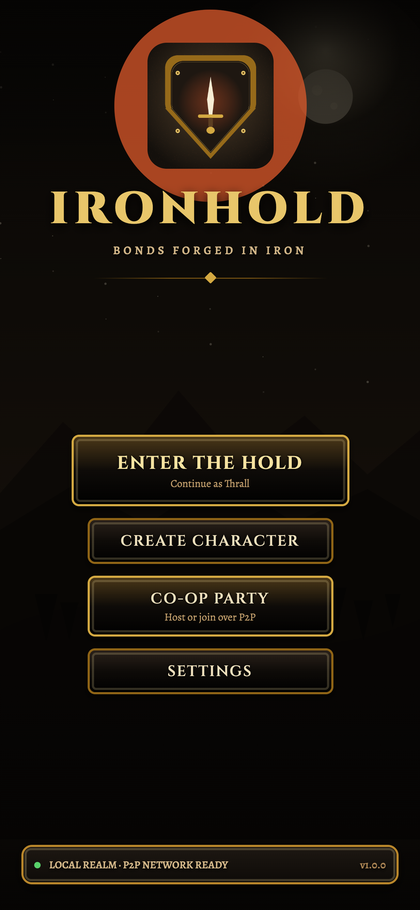
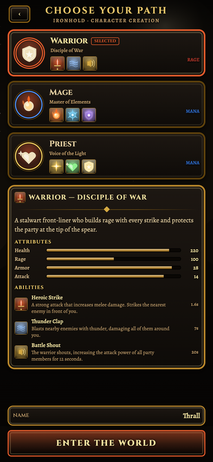
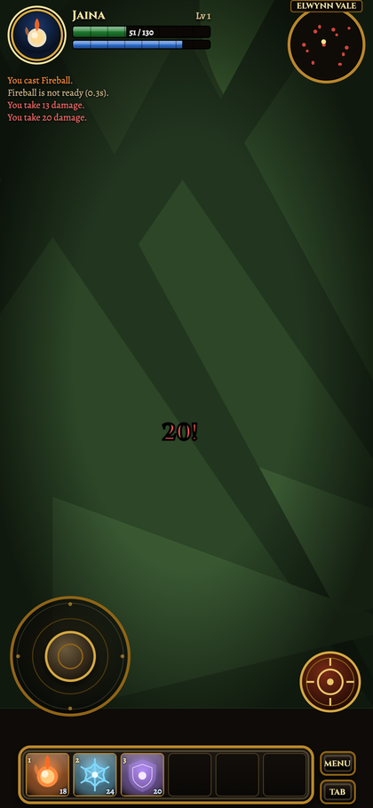
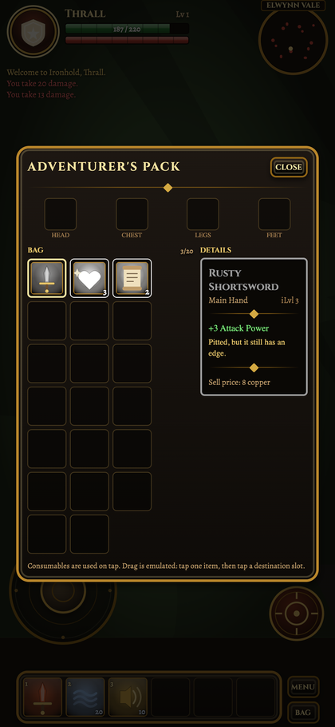
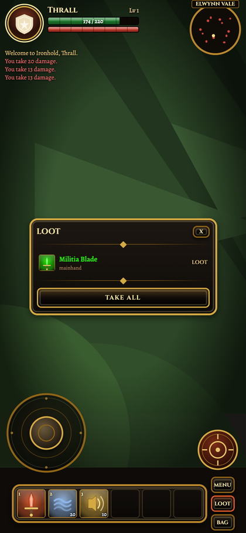
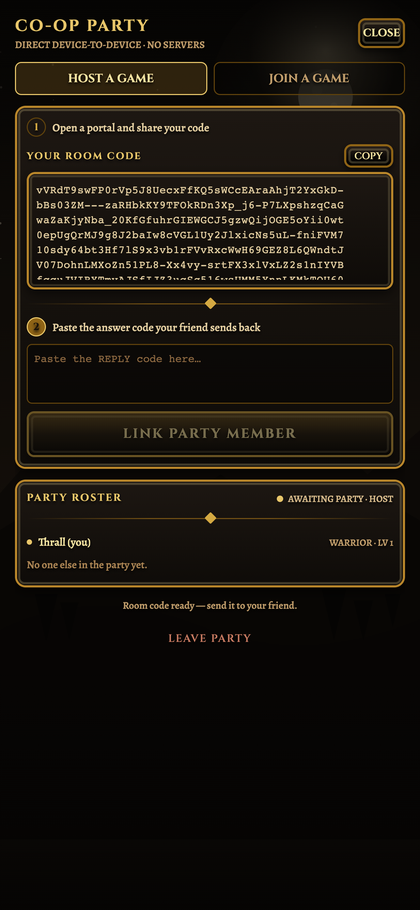

# Ironhold — Co-op Action RPG

A mobile-first co-op Action-RPG for iOS in the visual language of **World of Warcraft Classic**:
parchment-and-gold frames, riveted iron panels, low-poly stylized characters, a grid inventory and a
classic hotbar — built on **React Native + Expo + TypeScript**, styled with **NativeWind**, and networked
with **serverless WebRTC peer-to-peer** data channels.

> **No game server.** One device hosts and the others join directly, peer-to-peer.

| | |
|---|---|
|  |  |
| Main menu | Character selection |
|  |  |
| Combat HUD | Grid inventory + tooltip |
|  |  |
| Loot window | P2P party code |

---

## Stack

| Concern | Choice |
| --- | --- |
| Runtime | Expo SDK 54 · React Native 0.81 · New Architecture |
| Language | TypeScript, `strict` + `noUncheckedIndexedAccess` |
| Styling | NativeWind v4 + Tailwind CSS (custom parchment/gold palette) |
| State | Zustand (separate slices for game, world, net, inventory) |
| Networking | `react-native-webrtc` on device, browser `RTCPeerConnection` for the web preview |
| Rendering | `react-native-svg` scene graph (crisp at any density, cheap on mobile GPUs) |
| Testing | `node:test` via `tsx` against a framework-free engine layer |

---

## Getting started

```bash
npm install
npm run ios      # device/simulator build — required for WebRTC (expo run:ios)
npm run web      # browser preview of the UI (no native WebRTC module)
npm run typecheck
npm test
```

> The web target is a **UI preview**. `react-native-webrtc` is a native module, so true P2P between two
> phones needs `npx expo run:ios` (or a dev client), not Expo Go.

---

## Architecture

```
src/
  engine/          Pure TypeScript simulation — no React Native imports, fully unit tested
    world.ts         fixed-step world: movement, abilities, enemy AI, loot drops
    inventory.ts     bag slots, stacking, merging, deterministic loot rolls
    protocol-adjacent rng.ts — seeded xorshift so peers agree on rolls
  game/            Static data: classes, abilities, items, loot tables
  net/             WebRTC transport
    protocol.ts      wire envelope + room-code codec (deflate + base64url)
    webrtc.ts        platform adapter (native module vs browser)
    session.ts       Host / Join sessions, star-mesh relay, roster
    sync.ts          compact world <-> wire snapshots
    useCoopSync.ts   React hook bridging session messages and the world store
  store/           Zustand slices bridging engine <-> UI
  ui/              Presentational: Frame, HUD, WorldRenderer, Joystick, InventoryPanel, LootWindow
  screens/         Main menu, character select, game, multiplayer panel
tests/             58 tests over the engine, protocol and session logic
```

The engine deliberately imports **nothing** from React Native, so the same rules run in `node:test`, on the
host and on every joiner.

### Why the simulation lives in one place

The **host is the authority**: it advances the world at a fixed 30 Hz step and broadcasts a compact
snapshot at 12 Hz. Joiners send input/cast intents and render the authoritative state. This keeps damage,
enemy AI and loot deterministic on one machine instead of trying to converge N independent simulations.

Loot rolls are seeded from `(worldSeed, enemyId)` so every peer can reproduce the same drop.

### Networking model

* The host creates one `RTCPeerConnection` per joiner; its SDP becomes a **room code**.
* The joiner returns an **answer code**; the host links it to the open invitation by ICE ufrag.
* Joiners each hold a single peer connection; the host relays state between them (**star mesh**), so
  N players need N-1 connections rather than a full N² mesh.
* Two data channels: ordered-reliable for casts/loot/chat, unordered-unreliable for state frames.
* Room codes are `deflate` + `base64url`, turning a ~2 kB SDP into ~700 characters that fit in a text message.
* ICE candidates are gathered into the SDP so a code remains valid after being pasted seconds later, and
  late candidates are re-sent over the control channel for multi-homed devices.

---

## Verification

```
npm run typecheck   # clean
npm test            # 58 passing
npm run build:web   # clean production web bundle
```

The UI was verified in a real headless Chromium at iPhone dimensions (393×852) with automated checks for
layout overflow, rendered content, HUD colour accuracy (green HP / class resource colour), inventory slot
count, tooltip contents, and the full loot → take-all → bag flow.

### Known harness limitation

This machine has no Xcode, so the iOS build itself could not be compiled here. Headless Chromium in this
sandbox also refuses to complete ICE when signalling is delayed (it only connects when the remote
description is applied in the same task turn), which is a engine-level restriction rather than an app bug.
The signalling codec and mesh relay are therefore covered exhaustively by `tests/session.test.ts` with a
faithful fake transport, and the real data-channel path is exercised by `tools/webrtc-e2e.mjs`.
On real devices WebKit performs ordinary trickle ICE across arbitrary signalling gaps.

---

## Milestones

| # | Commit | Scope |
| --- | --- | --- |
| 1 | `feat: initialize expo project with git and tailwind` | Expo + TS + NativeWind, assets, git |
| 2 | `feat: add wow-classic styled mobile hud and character selection` | HUD, menus, character select, world renderer |
| 3 | `feat: implement webrtc p2p mesh networking and data channels for co-op` | Protocol, room codes, sessions, mesh relay |
| 4 | `feat: add character movement, combat abilities, and synced pve enemies` | Joystick, abilities, enemy AI, state sync |
| 5 | `feat: add grid inventory and p2p synchronized loot drops` | Bag grid, tooltips, loot rolls, take-all |
